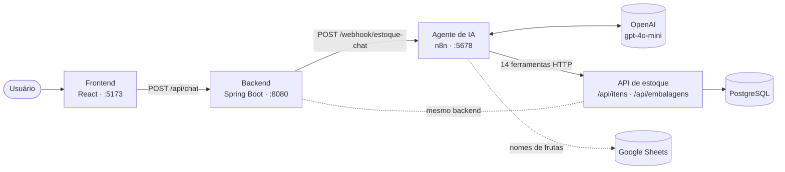

<h1 align="center">🥬 Gestão de Estoque com Agente de IA</h1>

<p align="center">
  Sistema de controle de estoque para hortifruti que pode ser operado <b>conversando em linguagem natural</b>.<br>
  Um agente de IA construído no <b>n8n</b> entende o pedido, escolhe a operação certa e executa pela API, com validações que protegem o banco.
</p>

<p align="center">
  
  
  
  
  
  
  
</p>

---

## 📌 Sobre o projeto

Fazer operações em um banco de dados normalmente exige saber SQL e conhecer a estrutura das tabelas. Neste projeto, o funcionário do hortifruti só precisa escrever o que aconteceu:

> **Você:** Chegaram 20 bananas
> **Assistente:** Pronto! Entrada de 20 unidades de Banana. Saldo atual: 150.

O pedido passa por um **agente de IA no n8n**, que usa o modelo **gpt-4o-mini** da OpenAI para entender a intenção, extrair os dados (produto, quantidade, preço) e chamar uma das **14 ferramentas** disponíveis. As ferramentas chamam a **API REST em Spring Boot**, que valida tudo antes de gravar no **PostgreSQL**. **O modelo de IA nunca acessa o banco diretamente.**

Projeto desenvolvido como **Trabalho de Conclusão de Curso** do Bacharelado em Sistemas de Informação do **Centro Universitário de Fernandópolis (UNIFEF)**.

---

## 📸 Telas

<p align="center">
  <br>
  <sub><b>Assistente IA</b>: chat com o agente e painel de comandos com status em tempo real</sub>
</p>

<table>
  <tr>
    <td align="center" width="50%">
      <br>
      <sub><b>Início</b>: indicadores, reposição e estoque por categoria</sub>
    </td>
    <td align="center" width="50%">
      <br>
      <sub><b>Itens</b>: busca, filtros, situação do estoque e valor</sub>
    </td>
  </tr>
</table>

<p align="center">
  <br>
  <sub><b>Workflow no n8n</b>: Webhook → Agente de Estoque (OpenAI) → 14 ferramentas → resposta</sub>
</p>

---

## ✨ Funcionalidades

**Pela tela**
- Painel inicial com indicadores, lista de reposição e estoque por categoria
- Lista de itens com busca instantânea, filtros, ordenação e situação (OK, Baixo, Zerado)
- Cadastro e edição de produtos com pré-visualização
- Exclusão lógica: o produto é inativado e pode ser reativado

**Pelo assistente de IA**
- Consultar estoque, preços, categorias e produtos com estoque baixo
- Cadastrar produtos (o agente **pergunta** quantidade e preço se faltar)
- Dar entrada, dar saída e ajustar o saldo
- Atualizar e inativar produtos (com **confirmação** antes de excluir)
- Cadastrar embalagens (ex.: *"a caixa M de limão tem 30 unidades"*) e dar entrada por caixa
- Reconhecer nomes alternativos de frutas por uma planilha no Google Sheets (ex.: *tommy* → Manga)

**Painel de comandos**
- Cada mensagem vira um comando com status **Sucesso**, **Processando** ou **Erro**
- Atualização automática, filtros por status, abas Hoje/Tudo e botão para zerar o histórico

---

## 🏗️ Arquitetura



1. A tela envia a mensagem ao backend, que registra o comando.
2. O backend repassa a mensagem, o histórico e o estado da conversa ao webhook do n8n.
3. O agente consulta o modelo da OpenAI para decidir o que fazer.
4. O agente chama uma das ferramentas, e cada ferramenta faz uma requisição HTTP à API.
5. A API valida a operação e grava no PostgreSQL; a resposta volta pelo mesmo caminho até a tela.

---

## 🛡️ Travas de segurança

Como o modelo de IA pode errar, as regras críticas ficam no **backend** e não dependem do prompt:

| Trava | O que impede |
|---|---|
| O modelo não escreve SQL | Só existem 14 ferramentas fixas; as consultas usam JPA com parâmetros |
| Saldo nunca negativo | Saída maior que o estoque é recusada |
| Entrada só para produto cadastrado | O agente não consegue criar produto "sem querer" |
| Nome duplicado bloqueado | Não existem dois produtos ativos com o mesmo nome |
| Trava de repetição (30 s) | A mesma operação repetida em sequência não é executada de novo |
| Exclusão lógica | Nenhum produto é apagado de verdade; o histórico é preservado |
| Confirmação antes de excluir | O agente sempre pergunta antes de inativar |

---

## 🧰 Tecnologias

| Camada | Tecnologia |
|---|---|
| Frontend | React + Vite, Axios, React Icons |
| Backend | Java 21, Spring Boot 3.2, Spring Data JPA / Hibernate 6.3, Lombok, springdoc-openapi (Swagger) |
| Banco de dados | PostgreSQL |
| Automação | n8n (Tools Agent + HTTP Request Tools + Webhook) |
| IA | OpenAI API, gpt-4o-mini (temperatura 0,2) |
| Dados auxiliares | Google Sheets (nomes padrão de frutas) |

---

## 🚀 Como executar

### Pré-requisitos

- Java 21 e Maven
- Node.js 18 ou superior
- PostgreSQL
- Docker (para o n8n)
- Chave de API da OpenAI ([platform.openai.com](https://platform.openai.com/api-keys))

### 1. Banco de dados

Crie um banco vazio no PostgreSQL (o nome abaixo é um exemplo):

```sql
CREATE DATABASE estoque;
```

As tabelas são criadas automaticamente pelo Hibernate na primeira execução.

### 2. Backend

Configure o `backend/src/main/resources/application.properties`:

```properties
spring.datasource.url=jdbc:postgresql://localhost:5432/estoque
spring.datasource.username=postgres
spring.datasource.password=SUA_SENHA
spring.jpa.hibernate.ddl-auto=update

# Integração com o n8n (o workflow precisa estar ATIVO)
n8n.webhook.url=http://localhost:5678/webhook/estoque-chat
n8n.timeout.conexao-ms=5000
n8n.timeout.leitura-ms=120000
```

```bash
cd backend
mvn spring-boot:run
```

A API sobe em `http://localhost:8080` e a documentação fica em `http://localhost:8080/swagger-ui.html`.

### 3. n8n

```bash
docker run -it --rm --name n8n -p 5678:5678 \
  -v n8n_data:/home/node/.n8n \
  --add-host=host.docker.internal:host-gateway \
  docker.n8n.io/n8nio/n8n
```

1. Acesse `http://localhost:5678` e crie sua conta local.
2. Vá em **Workflows → Import from File** e selecione `n8n/Agente_de_Estoque_OpenAI.json`.
3. No nó **OpenAI Chat Model**, crie a credencial com a sua chave da OpenAI.
4. No nó **consultar_dataset_frutas**, conecte sua credencial do Google Sheets.
5. Ative o workflow (botão **Active**).

> As ferramentas usam `http://host.docker.internal:8080` para alcançar o backend fora do container. Se o n8n estiver instalado direto na máquina (sem Docker), troque por `http://localhost:8080`.

### 4. Frontend

```bash
cd frontend
npm install
npm run dev
```

Acesse `http://localhost:5173` e abra a tela **Assistente IA**.

---

## 💬 Exemplos de comandos

| Mensagem | O que acontece |
|---|---|
| `Quanto tem de kiwi?` | Consulta o saldo |
| `O que preciso repor?` | Lista produtos com estoque baixo ou zerado |
| `Cadastra pera` | O agente pergunta quantidade e preço antes de gravar |
| `Chegaram 20 bananas` | Entrada de estoque |
| `Vendi 5 peras` | Saída de estoque (recusada se faltar saldo) |
| `Contei as peras, tem 28` | Ajusta o saldo exato |
| `A caixa M de limão tem 30 unidades` | Cadastra a embalagem |
| `Chegou uma caixa M de limão` | Entrada de 30 unidades |
| `Exclui a cenoura` | Pede confirmação e inativa |

---

## 🔌 Principais rotas da API

| Método | Rota | Descrição |
|---|---|---|
| `POST` | `/api/chat` | Envia uma mensagem ao agente |
| `GET` | `/api/chat/{sessaoId}/mensagens` | Histórico da conversa |
| `GET` | `/api/itens` | Lista os itens ativos |
| `POST` | `/api/itens` | Cadastra um item |
| `PUT` | `/api/itens/{id}` | Atualiza um item |
| `GET` | `/api/itens/estoque-baixo` | Itens com estoque baixo ou zerado |
| `POST` | `/api/itens/adicionar-por-nome` | Entrada de estoque |
| `POST` | `/api/itens/remover-por-nome` | Saída de estoque |
| `PATCH` | `/api/itens/definir-por-nome` | Ajuste de saldo |
| `PATCH` | `/api/itens/{id}/inativar` | Exclusão lógica |
| `GET` | `/api/embalagens` | Lista as embalagens |
| `POST` | `/api/embalagens/definir-por-nome` | Cadastra ou atualiza uma embalagem |
| `GET` | `/api/comandos/recentes` | Comandos do painel |
| `POST` | `/api/comandos/zerar` | Zera o histórico de comandos |

A lista completa está no Swagger.

---

## 🧪 Testes

Foram executados **56 testes funcionais** pelo chat do sistema, **4 para cada uma das 14 ferramentas** do agente, cobrindo pedidos típicos, variações de linguagem, casos-limite e casos de erro.

| Grupo | Casos | Aprovados |
|---|:---:|:---:|
| Consultas (ferramentas 1–6) | 24 | 24 |
| Escrita (ferramentas 7–13) | 28 | 28 |
| Planilha de frutas (ferramenta 14) | 4 | 4* |
| **Total** | **56** | **56** |

<sub>* Um caso foi aprovado após correção. Taxa de aprovação na 1ª execução: 98,2%; final: 100%, sem nenhuma alteração indevida no banco.</sub>

---

## 📁 Estrutura do repositório

```
gestao-estoque-agente-ia/
├── backend/                 # API REST em Spring Boot
│   └── src/main/java/com/estoque/sistema/
│       ├── controller/      # Itens, Embalagens, Chat, Comandos
│       ├── service/         # Regras de negócio e trava de repetição
│       ├── model/           # Entidades JPA
│       ├── repository/
│       ├── dto/
│       └── config/
├── frontend/                # Interface em React + Vite
│   └── src/
│       ├── pages/           # Início, Itens, Cadastro, Assistente IA
│       ├── components/
│       ├── services/        # Chamadas à API (Axios)
│       └── styles/
├── n8n/
│   └── Agente_de_Estoque_OpenAI.json   # Workflow do agente
└── docs/
    └── img/                 # Prints usados neste README
```

---

## 👥 Autores

| Nome | Contato |
|---|---|
| Igor Gabriel De Oliveira Reis | igorgabriel2805@gmail.com |
| Mateus Tomaz Siqueira | mateustomaaz@gmail.com |
| Pedro Emmanuel Amaral Martins | pedromartinsstr@gmail.com |
| Victor Junio Grigoleto Chicas | victorchicas525@gmail.com |

**Orientador:** Prof. Jefferson Antonio Ribeiro Passerini

Centro Universitário de Fernandópolis (UNIFEF) · Bacharelado em Sistemas de Informação · 2026

---

<p align="center"><sub>Projeto acadêmico desenvolvido para fins de estudo.</sub></p>
